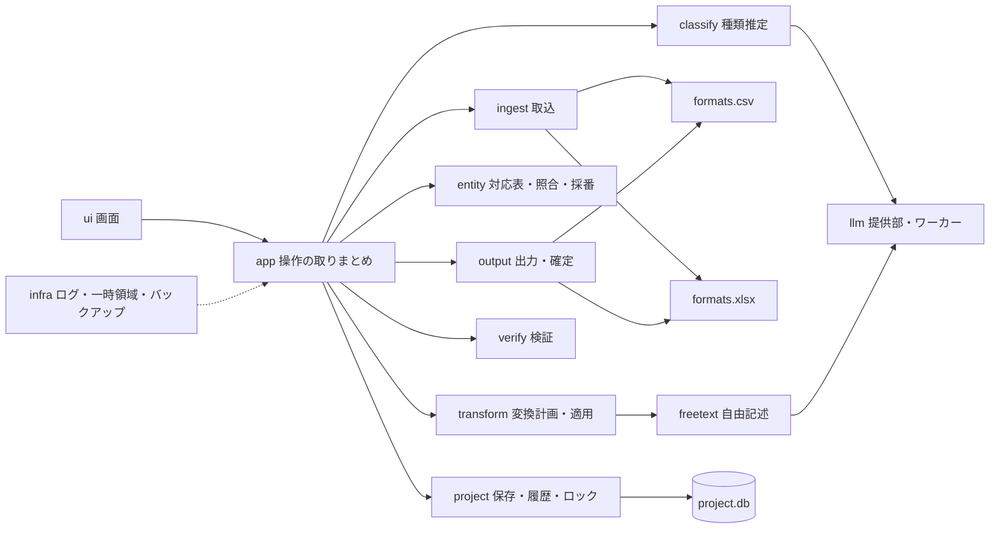
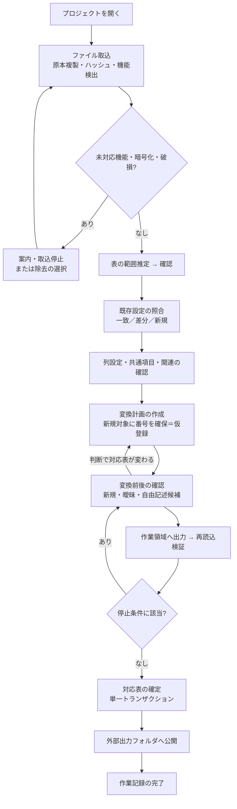

# 02 技術構成・モジュール構成・処理フロー

## 1. 技術構成の候補比較

### 1.1 アプリ本体

| 観点 | 案A：Python + PySide6（推奨） | 案B：.NET 8 + WPF + Open XML SDK | 案C：Tauri/Electron + TypeScript |
|---|---|---|---|
| 表データ処理 | 豊富（csv, lxml, decimal, 文字列照合ライブラリ） | 十分 | xlsx系ライブラリは機能維持に制約が多い |
| xlsx部品単位の編集 | zipfile + lxml で実装可能 | Open XML SDK が最も得意 | 自前実装が必要 |
| ローカルLLM連携 | OpenVINO GenAI、llama.cpp等のPython APIが充実 | OpenVINO C API、LLamaSharp 等。選択肢は少なめ | 子プロセス連携が中心 |
| Windows配布 | PyInstaller等で可能。サイズ大・起動やや遅い | 単一配布物が作りやすい | 配布容易だが実行環境が二重 |
| 開発速度（生成AI併用） | 高い | 中 | 中 |
| GUI | Qt：仮想表示の表（QTableView）が標準 | WPF：DataGrid仮想化あり | Web技術で自由度高 |

**採用：案A（Python 3.12 系 + PySide6）。**（2026-11-03 確定）
理由：決定的な変換・検証ロジックとLLM連携を同じ言語で書け、合成データによる自動試験も書きやすい。Excelの部品単位編集はOpen XML SDK（案B）の方が堅いが、本設計では編集対象をセル値・共有文字列・一部キャッシュに限定するため、zipfile + lxmlで実装可能と判断した。案Bは、案Aで配布・性能上の問題が出た場合の代替とする。

### 1.2 主要ライブラリ（推奨）

| 用途 | ライブラリ | ライセンス（要確認事項） |
|---|---|---|
| GUI | PySide6 (Qt for Python) | LGPLv3。動的リンク・差し替え可能な配置（onedir配布）で利用。ライセンス文の同梱が必要 |
| xlsx 読み書き | 標準 zipfile + lxml | lxml: BSD。XML外部実体の無効化・巨大ツリー制限を必須設定 |
| xlsx 検証用の第二読込 | openpyxl | MIT。**出力の書き込みには使わない**（公式文書に「読み込めない要素があり、開いて保存すると図形が失われる」旨の注意がある） |
| CSV | 自前の字句解析器（引用符有無を記録）＋標準csvで照合試験 | ― |
| 文字コード推定（補助） | charset-normalizer | MIT |
| 多語句検索 | pyahocorasick | BSD-3 |
| 類似名称候補 | rapidfuzz | MIT |
| 保存 | SQLite（標準 sqlite3） | Public Domain |
| LLM 実行（第1候補） | OpenVINO GenAI | Apache-2.0 |
| LLM 実行（第2候補） | llama.cpp（llama-server または Python バインディング） | MIT |
| 配布 | PyInstaller（onedir）+ Inno Setup | PyInstaller: GPL（ブートローダ例外あり）／Inno Setup: 独自ライセンス（商用利用可否を確認） |
| 試験 | pytest, hypothesis | MIT / MPL-2.0 |

**ライセンス確認事項**：上記は一般に知られたライセンス区分であり、採用時に各配布物の LICENSE を確認する。特に LLMモデル本体は モデルごとに利用条件が異なる（商用利用・再配布可否）ため、モデル選定時に個別確認を必須とする。

### 1.3 ローカルLLM の実行方式（検証事項を含む）

公式資料で確認できた事項：
- OpenVINO 2025.0 のリリースノートに、Intel Core Ultra 200V シリーズの CPU・内蔵GPU・NPU が公式サポート対象として記載されている（[Intel OpenVINO 2025.0 Release Notes](https://www.intel.com/content/www/us/en/developer/articles/release-notes/openvino/2025-0.html)）。同時に、Core Ultra 200V 上の CPU プラグインのセグメンテーション違反や、GPU での一部モデル精度低下といった既知の問題も記載されている。
- OpenVINO GenAI は `LLMPipeline(model_path, "NPU")` のように実行デバイスを指定できる（[NPU with OpenVINO GenAI](https://docs.openvino.ai/2025/openvino-workflow-generative/inference-with-genai/inference-with-genai-on-npu.html)）。

確認できなかった事項（**検証事項**）：
- Arc 140V（Lunar Lake 内蔵GPU）での llama.cpp の Vulkan / SYCL バックエンドの公式なサポート状況。コミュニティ報告では Vulkan で認識される例がある一方、不安定さの報告もあり、公式文書による確認はできていない。
- 特定モデルの日本語での種類推定・固有名詞検出の精度、各デバイスでの速度。**これらは断定しない。**

推奨構成：
1. LLM 呼び出しを `LLMProvider` という抽象境界の背後に置き、実装を差し替え可能にする。
2. 第1候補を OpenVINO GenAI（CPU/GPU/NPU を設定で選択、既定は CPU）、第2候補を llama.cpp（CPU）とする。
3. LLM は **別プロセス（ワーカー）** で実行し、本体とは標準入出力のパイプで通信する（ローカルHTTPポートを開かない）。ワーカーの異常終了・タイムアウトは本体に影響させない。
4. 使用モデルは「モデルパック」として初回セットアップ時に取得し、ハッシュ値を検証して保存する。業務データ処理中にモデルやライブラリを取得する処理は一切実行しない。

### 1.4 段階5 の実機検証の結果と決定（2026-11-04）

業務用の端末は開発用 PC と同じ構成（Intel Core Ultra 7 258V、Intel Arc 140V GPU、NPU、メモリ 32GB）であることを利用者に確認した。

- 実行基盤：OpenVINO GenAI 2026.4（`openvino-genai`）。CPU・GPU・NPU のすべてで動作を確認した。llama.cpp は使わない。
- モデル：OpenVINO 形式に変換済みの公開モデルを比較し（合成の文章 60 件、09 章「段階5 の実装結果」）、**Qwen3-4B（int4、Apache-2.0）を GPU で使う**ことを既定の推奨にした。8B は速度・検出率とも 4B を上回らなかった。NPU は動作するが GPU より遅い。CPU は GPU が使えない場合の代替とする。Gemma は利用条件が独自のため候補から外した。

| モデル（すべて int4、Apache-2.0） | 処理装置 | 読込 | 1文あたり | 検出率 | 誤った候補（60文中） |
|---|---|---|---|---|---|
| Qwen3-4B | GPU（Arc 140V） | 2.0 秒（2回目以降。初回は約15秒） | 0.28 秒 | 92.5% | 3 |
| Qwen3-4B | CPU | 10.3 秒 | 0.79 秒 | 87.5% | 4 |
| Qwen3-8B | GPU | 14.8 秒 | 0.48 秒 | 87.5% | 5 |
| Qwen3-8B（NPU 用 cw） | NPU | 32.0 秒 | 0.87 秒 | 90.0% | 12 |

- モデルの置き場所：アプリにもリポジトリにも含めず、端末内のフォルダ（例 `C:\Users\<利用者>\maskapp_models\Qwen3-4B-int4-ov`）を「AI の設定」で指定する。モデルの取得（ダウンロード）は業務データを扱わないプロセスで行う。配布方法（モデルパック）は段階6で決める。
- GPU 向けに変換した結果はアプリ用フォルダの `model_cache\` に保存する（2回目以降の読込が速くなる。業務データは含まない）。

## 2. Windows 配布

| 項目 | 推奨 |
|---|---|
| 形式 | PyInstaller onedir ＋ Inno Setup によるユーザー単位インストーラ（管理者権限不要） |
| 依存の固定 | ハッシュ付きロックファイル（uv 等）で依存バージョンを固定し、ビルドを再現可能にする |
| モデル | 本体と別配布。「モデルの追加」画面で、ローカルに置いたモデルパック（フォルダ）を指定して取り込む方式を基本にする。オンライン取得は別メニューに分け、業務データを開いていない状態でのみ実行可能にする |
| 更新 | 自動更新しない。新版インストーラを手動で実行する |
| 署名 | コード署名は推奨（未決：証明書の入手） |
| 通信 | 本体は通信機能を持たない設計とする（オンライン取得メニュー以外）。試験で通信が発生しないことを確認する |

## 3. モジュール構成と責務



| モジュール | 責務 | 主な依存 |
|---|---|---|
| `ui` | 画面、仮想表示、操作の受付。業務ロジックを持たない | app |
| `app` | 画面操作を手順（取込→設定→確認→検証→出力）に変換。状態遷移の管理 | 全core |
| `project` | プロジェクトの作成・開閉、ロックファイル、SQLiteアクセス、設定版・対応表版、作業履歴 | sqlite3 |
| `formats.csv` | 文字コード・BOM・区切り・改行・引用符の検出、全値を文字列で保持する読込、変更行だけ再直列化する書込 | ― |
| `formats.xlsx` | パッケージ（ZIP）解析、部品一覧と機能検出、セル読込、セル値・共有文字列の差し替え書込、全テキスト部品の抽出 | zipfile, lxml |
| `ingest` | ファイル判定（暗号化・破損・形式）、表の範囲推定、列の型プロファイル、設定再利用の照合 | formats |
| `classify` | 列の情報種類推定（列名辞書・正規表現・値の形）、LLM候補の取込 | llm |
| `entity` | 対象・コード・名称・別名の管理、照合、番号確保、統合・分離・影響表示 | project |
| `freetext` | 既知語句辞書の構築、自由記述の検出・置換（最長一致・非再置換）、規則による候補検出 | pyahocorasick, llm |
| `transform` | 変換計画（どのセルを何に変えるか）の作成、プレビュー用データ、要確認項目の生成 | entity, freetext |
| `verify` | 構造・維持値・置換一貫性・関係・残存語・未確認件数の検査、元由来／変換由来の区別 | formats |
| `output` | 作業領域への書出し、再読込検証、対応表確定、外部フォルダへの公開、復旧 | formats, verify |
| `llm` | `LLMProvider` 抽象、ワーカープロセス管理、入出力の検証（JSON形式・元テキストに含まれる語句か） | OpenVINO GenAI / llama.cpp |
| `infra` | 値を含めないログ、例外の伏字化、一時領域（プロジェクト内）、自動バックアップ | ― |

依存方向：`ui → app → core各部 → infra`。core は ui に依存しない（自動試験・CLI から同じ処理を呼べる）。

## 4. 処理フロー



各段階の状態とトランザクション境界は [07_verification_output.md](07_verification_output.md) で定義する。

## 5. 想定ディレクトリ構成（ソースコード）

```
src/maskapp/
  ui/            画面
  app/           手順・状態遷移
  project/       保存・版管理
  formats/csv/   CSV
  formats/xlsx/  xlsx パッケージ
  ingest/ classify/ entity/ freetext/ transform/ verify/ output/ llm/ infra/
tests/
  synthetic/     合成データ生成器（実データは置かない）
  scenarios/     受入シナリオ試験
docs/design/     本設計書
```
