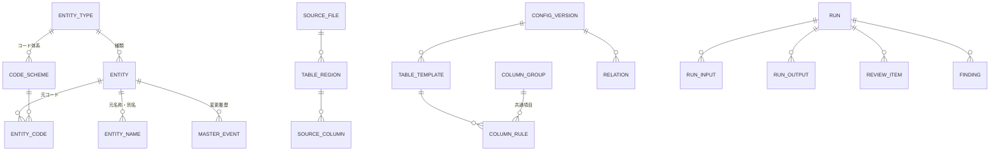

# 03 データモデル

1プロジェクト＝1つの SQLite ファイル（`project.db`）。プロジェクト間でテーブルを共有しない。
`project.db` は元の語句を含むため**機密情報**として扱い、外部出力フォルダに置かない。

## 1. 全体像

大きく次の2系統に分ける（依頼書6章 A/B）。

- **A. 変換設定系**：表の定義、列ごとの規則、共通項目、関連、設定版
- **B. 対応表系**：種類、対象、コード、名称・別名、値対応、変更履歴、対応表版

両者をつなぐのが **変換作業（run）** で、各作業は使用した設定版と対応表版を記録する。

## 2. 対応表系（B）

### entity_type（種類）
| 列 | 説明 |
|---|---|
| id | 例：`CUSTOMER`, `PRODUCT`, `MATERIAL`, `PERSON`, 利用者定義 |
| display_name | 「顧客」 |
| name_prefix | 変換後名称の接頭語「顧客」 |
| name_digits | 番号の桁数（既定4）。超過時は桁を伸ばす（顧客10000） |
| next_name_seq | 次に確保する名称番号。**減らさない** |

同じ文字列でも種類が違えば別の対象（顧客「さくら」と製品「さくら」は別管理）。

### code_scheme（コード体系）
| 列 | 説明 |
|---|---|
| id, entity_type_id | どの種類のコードか |
| display_name | 「販売管理 得意先CD」 |
| components | 構成要素数（複合キーなら2以上。例：会社CD＋得意先CD） |
| format_rule | 元コードの観測形式：長さ（固定/可変）、文字種（数字/英数字/記号含む）、先頭ゼロ有無、接頭語 |
| output_rule | 変換後コードの生成規則：長さ・文字種・接頭語・使用範囲（[05_algorithms.md](05_algorithms.md) 3章） |
| next_code_seq | 次に確保するコード番号。**減らさない** |
| capacity | 生成可能な最大件数（採番枯渇の判定に使う） |

ファイルごとに異なるコード体系（販売管理の得意先CDと会計の取引先番号など）は別の code_scheme とし、同一の対象に複数体系のコードを持たせることで関連付ける。

### entity（対象）
| 列 | 説明 |
|---|---|
| id | 内部ID（UUID）。画面には出さない |
| entity_type_id | 種類 |
| name_seq | 確保済みの名称番号（変更しない） |
| masked_name | 変換後名称（例「顧客0007」） |
| status | `draft`（仮登録）／`confirmed`（確定）／`void`（取消・欠番）／`merged`（統合され他の対象へ転送） |
| merged_into | 統合先の対象ID |
| created_run_id / confirmed_run_id | どの作業で作られ確定したか |

### entity_code（元コードと変換後コード）
| 列 | 説明 |
|---|---|
| entity_id, code_scheme_id | |
| original_code | 元コード（文字列として保持。複合キーは要素の順序付き配列をJSONで保持） |
| original_cell_kind | 元のセルが数値か文字列か（xlsx） |
| masked_code | 変換後コード |
| code_seq | 確保済みのコード番号 |
| status | `draft`／`confirmed`／`void` |

一意制約：`(code_scheme_id, original_code)` と `(code_scheme_id, masked_code)`。→ 同一コード体系の同じコードは必ず1対象。

### entity_name（元名称・別名）
| 列 | 説明 |
|---|---|
| entity_id | |
| original_name | 元の表記（そのまま保持） |
| normalized_name | 照合候補用の正規化表記（[05_algorithms.md](05_algorithms.md) 2.4） |
| kind | `primary`（代表名）／`alias`（別名・略称）／`observed`（観測されたが別名として確認されていない） |
| status | `draft`／`confirmed`／`void` |

一意制約：`(entity_id, original_name)` のみ。**名称は複数の対象で重複してよい**（同名の別顧客を許容）。

### value_token（対象を持たない値の置換）
住所・電話・メール等、対象として管理しないが置換したい値。
| 列 | 説明 |
|---|---|
| info_type | `ADDRESS`, `PHONE`, `EMAIL` など |
| original_value, masked_value, seq, status | 種類ごとの連番で生成 |

### term（自由記述用の追加語句）
対象の名称・コード以外で、自由記述から検出・置換したい語句（担当者名の一部、プロジェクト名等）や、置換しない語句。
| 列 | 説明 |
|---|---|
| original_term | |
| link | 対象ID（あれば）または info_type |
| action | `replace`／`keep`（置換しないと確認済み＝誤検出として扱う語） |
| min_context | 短い語の場合の扱い（[05_algorithms.md](05_algorithms.md) 4章） |

### master_event（対応表の変更履歴）
| 列 | 説明 |
|---|---|
| seq | 通し番号＝**対応表版**（master revision） |
| run_id | どの作業での変更か（手動編集は管理作業として記録） |
| kind | `create`, `confirm`, `void`, `alias_add`, `alias_remove`, `merge`, `split`, `rename_masked`, `code_add` |
| payload | 変更前後（元語句を含むため project.db 内のみ） |

統合・分離・変換後名称の変更を行う場合は、`run_output` からその対象を使った過去の出力を逆引きし、影響一覧を表示してから実行する。

## 3. 変換設定系（A）

### source_file / table_region / source_column（観測された実体）
| テーブル | 主な列 |
|---|---|
| source_file | id, original_filename（機密）, stored_path, sha256, size, format, import_run_id |
| sheet | source_file_id, index, name（機密）, visibility（表示/非表示/完全非表示） |
| table_region | sheet_id, header_rows（複数行見出し可）, data_first_row, data_last_row, first_col, last_col, region_kind（データ表／注記／合計行） |
| source_column | region_id, col_index, header_text, type_profile（空欄率、数値/文字列/日付の比率、長さ分布、先頭ゼロ有無）, fingerprint |

### table_template（表の定義）と column_rule（列規則）
同じ構造の表（毎月の売上明細など）に共通する設定。ファイル名ではなく**列構成**で照合する。

| テーブル | 主な列 |
|---|---|
| table_template | id, config_version_id, display_name（例「売上明細」）, header_signature（見出しの正規化集合と順序）, region_rule（見出し行・データ範囲の決め方） |
| column_rule | template_id, header_text, position_hint, info_type, action（`keep`/`replace`/`clear`/`freetext`）, entity_type_id, code_scheme_id, role（`code`/`name`/`code_component(n)`/`other`）, column_group_id, header_action（見出し自体を検査するか）, review_state |

### column_group（共通項目）
「得意先CD」（売上明細）と「顧客番号」（顧客マスタ）を同じ情報として**明示的に**関連付ける単位。
| 列 | 説明 |
|---|---|
| id, display_name | 「顧客コード」 |
| entity_type_id, code_scheme_id, role | |

### relation（ファイル間の関連）
| 列 | 説明 |
|---|---|
| from_template / from_columns | 例：売上明細.得意先CD |
| to_template / to_columns | 例：顧客マスタ.顧客番号 |
| expected | `many_to_one` 等（検証で使う。元データが違っても勝手に直さない） |
| state | `suggested`／`confirmed`／`rejected` |

### config_version（設定版）
設定（table_template, column_rule, column_group, relation）は**版単位で不変**。変更すると新しい版を作り、前の版を残す。

## 4. 作業系

### run（変換作業）
| 列 | 説明 |
|---|---|
| id | |
| state | `draft` → `planned` → `staged` → `verified` → `committed` → `published`／`cancelled`／`failed` |
| config_version_id | 使用した設定版 |
| master_rev_base / master_rev_committed | 開始時と確定時の対応表版 |
| created_at, updated_at | |

### run_input / run_output
| テーブル | 主な列 |
|---|---|
| run_input | run_id, source_file_id, sha256, position（作業内の順序）, options（xlsx の扱いの選択：コメント除去・グラフ除去・画像の確認・数式の値への変換） |
| run_sheet | run_id, source_file_id, sheet_idx, template_name（表の定義を適用するシート。CSV はシート 0。スキーマ v3） |
| run_output | run_id, source_file_id, output_filename, output_path, sha256, size, published_at, staged_path, position |

1つの xlsx の複数シートにそれぞれ別の表の定義を適用できる（例：製造原価シートと製品一覧シート）。どの定義も適用しないシートも出力に含まれ、残存検査の対象になる。

出力ファイル自体には作業ID・対応表を埋め込まない（文書プロパティも初期化する）。追跡は project.db 側の sha256 で行う。

### review_item（要確認）
| 列 | 説明 |
|---|---|
| kind | `new_entity`, `code_multi_name`, `name_multi_code`, `similar_name`, `code_missing`, `freetext_candidate`, `type_ambiguous`, `column_change`, `excel_feature`, `residual` |
| location | ファイル・シート・行・列（値そのものは別列で保持） |
| decision | `register_new`, `link_existing`, `add_alias`, `keep`, `clear`, `false_positive` 等 |
| state | `open`／`decided` |

### finding（検証結果）
| 列 | 説明 |
|---|---|
| origin | `source`（元データ由来）／`transform`（変換由来）／`environment`（検査できない範囲） |
| severity | `block`（出力不可）／`warn`（確認すれば出力可）／`info` |
| kind, location, detail | |

## 5. 採番と番号の不変性（要点）

- 番号（`next_name_seq`, `next_code_seq`）は**確保時点で進め、戻さない**。
- 仮登録（draft）の対象にも番号を確保する。プレビューで見えた番号がそのまま確定時の番号になる。
- 作業を取り消すと、その作業で確保した仮登録は `void` となり番号は欠番になる（再利用しない）。
- 確定済みの対象は削除しない。不要になった場合も `void` 化して番号を保持する。
