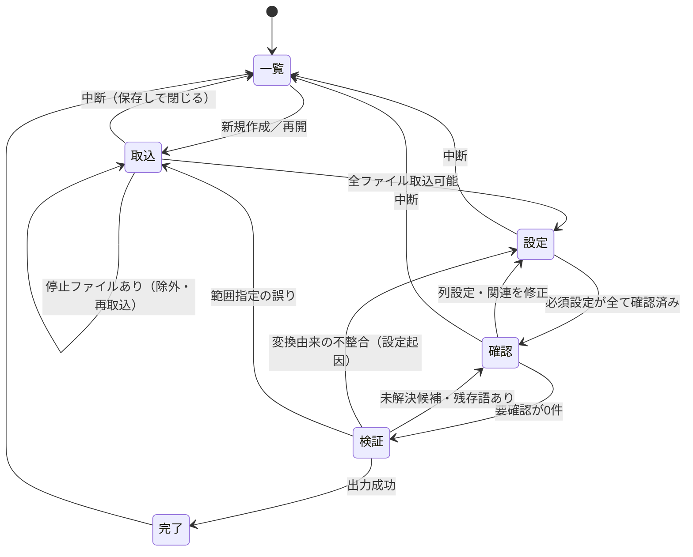

# 04 画面設計

## 0. 共通

- 画面上部に**プロジェクト帯**を常時表示：プロジェクト名、識別色、現在の手順（1〜5）、保存状態（「保存済み」「未保存の変更あり」）。
- 手順バー：①プロジェクト ②ファイル取込 ③変換設定 ④変換前後の確認 ⑤検証・出力。前の手順へはいつでも戻れる。後の手順へは前提条件を満たした場合のみ進める。
- 自動保存：判断・設定変更のたびに project.db へ保存。アプリ終了・異常終了後は同じ手順から再開できる。
- 画面下部に固定の注意文：「名称・コード等の置き換えであり、匿名化を保証するものではありません。」
- 主要画面では内部用語（エンティティ、トランザクション、スキーマ等）を使わない（用語表は [README.md](README.md)）。
- 元の値を表示する画面（③④⑤と対応表管理）には「元の値を表示中」の表示を出す。画面共有時に隠す「元の値を伏せる」切替を設ける。

## 1. 状態遷移

## 2. 画面1：プロジェクト一覧

| 表示項目 | 内容 |
|---|---|
| プロジェクト名・識別色 | |
| 最終更新日 | |
| ファイル数 | 取込済み原本数 |
| 対応表件数 | 種類別の確定件数（例：顧客 120／製品 45） |
| 作業状況 | 「取込中」「設定中」「確認中（要確認 12件）」「出力済み（日時）」 |
| 保存先 | プロジェクトフォルダ |

操作：新規作成（名前・保存先・識別色・外部出力フォルダの既定値）／開く／フォルダを開く／バックアップから復元／プロジェクトの削除（確認2段階）。

混用防止：
- 同時に開けるプロジェクトは1つ。別のプロジェクトを開くと現在のものは保存して閉じる。
- プロジェクトフォルダにロックファイルを置き、別のアプリ起動から同じプロジェクトを開けないようにする。
- 取込時、他のプロジェクトで取込済みのファイル（ハッシュ一致）であれば警告する（[10_open_issues.md](10_open_issues.md) 参照、既定は有効）。

## 3. 画面2：ファイル取込

操作：複数ファイルのドラッグ＆ドロップまたは選択。

一覧（1行＝1つの表の範囲）：

| 列 | 内容 |
|---|---|
| ファイル | 元ファイル名（機密扱い。伏せ表示可） |
| シート | シート名・表示状態（非表示シートは明示） |
| 見出し行 | 例「3行目」 |
| データ範囲 | 例「4〜1,250行目、A〜M列」 |
| 表の定義 | 適用した既存定義（例「売上明細」）または「新規」 |
| 適用状態 | 「一致」「列が追加されています」「列名が変わっています」「型が変わっています」「新しい表」 |
| 注意 | 未対応機能・表外の文字・非表示行列・コメント等の件数 |

表プレビュー（下部）：シートを格子で表示し、見出し行・データ範囲・表外（注記・タイトル）を色分け。範囲の端をドラッグまたは数値入力で修正。合計行らしい行（「合計」「計」等）は「データに含めない」候補として表示。

ファイル判定と案内：

| 判定 | 表示と対応 |
|---|---|
| 暗号化（パスワード付き） | 「パスワード付きのファイルは扱えません。Excelでパスワードを解除して保存し直してください」→ 取込停止 |
| 破損・読めない | 「ファイルを読み取れません」→ 停止 |
| .xls / .xlsm / .xlsb | 「この形式は対象外です。Excelで .xlsx として保存し直してください（マクロは失われます）」→ 停止 |
| 停止対象のExcel機能 | 機能名・場所・対処方法（[06_file_support.md](06_file_support.md)）→ 停止、または「除去して出力」を選択 |
| 警告対象の機能 | 内容を表示し、確認チェックで続行 |

既存設定の再利用：見出しの構成で照合（ファイル名は参考表示のみ）。差分は「追加された列」「なくなった列」「名前が変わった可能性のある列」「型の変化（例：数値だった列に文字列が混在）」として表示し、確認を求める。

## 4. 画面3：変換設定

### タブA：列設定

| 列 | 内容 |
|---|---|
| 表 / 列名 | |
| サンプル | 先頭の異なる値を最大5件（伏せ表示切替可） |
| 推定した情報の種類 | 例「顧客名」。推定元を小さく表示（「列名から」「値の形から」「AI候補」） |
| 処理 | 維持／置換／内容を消す／文章内を検査 |
| 種類・コード体系 | 置換時、どの種類（顧客等）のどのコード体系か |
| 確認 | 未確認／確認済み／変更あり |

操作：複数行を選んで一括で処理・種類を設定／「推定どおりで確認」一括確認／見出し自体を検査対象にする（横長の表で見出しに取引先名が並ぶ場合）。

表外の領域（タイトル・注記）：「そのまま」「文章内を検査」「内容を消す」を領域ごとに選択。既定は「文章内を検査」。

### タブB：ファイル間の関連

| 表示 | 内容 |
|---|---|
| 共通項目 | 「顧客コード」「製品コード」など |
| 各表の対応列 | 売上明細.得意先CD ↔ 顧客マスタ.顧客番号 |
| 関連候補 | 値の重なり率・見出しの類似から**候補**として表示（自動確定しない） |
| 照合結果（元データ） | 一致件数、未一致件数、参照先の重複件数 |

操作：候補を確定／却下、手動で列を追加。未登録コード（売上明細にあるが顧客マスタにない）は「元データの未一致」として件数と一覧を表示。

## 5. 画面4：変換前後の確認

上部：要確認の件数（種類別）。0件になるまで⑤へ進めない。

| 区分 | 操作 |
|---|---|
| 新しい対象（例：新規顧客 8件） | 一覧で変換後名称を確認し一括確定。個別に「既存の対象に紐付け」「別名として登録」へ変更可 |
| 同じコードに複数の名称 | 「別名として登録」／「元データの誤りとして残す（コードの対象名で置換）」 |
| 同じ名称に複数のコード | 既定は別の対象。必要なら「同じ対象として統合」（影響表示付き） |
| 似た名称（正規化で一致） | 「同じ対象（別名登録）」／「別の対象」 |
| コードが空欄で名称のみ | 名称で照合した結果の確認。同名が複数あれば対象を選ぶ |
| 文章内の新しい候補 | 「置換する（種類を選ぶ／既存対象へ紐付け）」「置換しない（誤検出）」 |
| 種類が曖昧な語句 | 文章内の語が顧客名と製品名の両方に該当 → 種類を選ぶ |

比較表示：左右に元／変換後。変更セルを強調。フィルタ「全行」「変更行」「要確認行」。大きいファイルは表示範囲だけを読み込む仮想表示とし、全件を画面に載せない。

プレビューで表示される番号は確保済みのもので、確定出力でも同じになる旨を表示する。

## 6. 画面5：検証・出力

検証結果（[07_verification_output.md](07_verification_output.md)）を項目ごとに表示：

| 項目 | 表示例 |
|---|---|
| 行数・列数・シート構成 | 「すべて一致」 |
| 維持した値 | 「金額・数量・日付 等 18列、48,210セルが一致」 |
| 集計（参考） | 列ごとの合計・件数の一致（合格判定は上のセル一致で行う） |
| 関連 | 「売上明細→顧客：一致 1,180／元からの未一致 3（変化なし）」 |
| 元の語句の残り | 「検出 0件」または該当箇所一覧（クリックで④へ） |
| 未確認 | 0件 |
| 検査できない範囲 | 「画像 2点の中身は検査していません」等 |

区分表示：**元データからの不備**（未一致コード、元の重複）と**変換で生じた不備**を分けて表示。後者が1件でもあれば出力不可。

出力指定：出力先フォルダ（原本フォルダ・プロジェクトフォルダ内は不可または警告）、対象ファイル、出力ファイル名（既定は「{表の定義名}_{連番}.xlsx」等。元のファイル名を使う場合は名前に含まれる語句を検査）。

完了表示の文言：「出力しました（検査項目：…／検査の対象外：…）」。**「完全匿名化済み」「安全」等とは表示しない。**

## 7. 補助画面：対応表の管理

- 検索：元コード・元名称・別名・変換後名称・変換後コードで検索（種類で絞込み）。
- 対象の詳細：コード一覧（体系別）、名称・別名、使用された出力（作業と出力ファイル名）。
- 操作：別名追加・削除、統合、分離、変換後名称の変更、取消（欠番化）。いずれも実行前に「影響する出力ファイル一覧」と「過去の出力と表記が変わる」旨を表示し、確認後に実行。
- 画面上部に「元の情報を含む画面です。外部への共有に使わないでください」と表示。この画面からは外部出力フォルダへの書き出しを行わない（対応表の書き出しは、機密扱いのファイルとしてプロジェクトフォルダ内にのみ可能）。

## 8. 追加ファイル時の流れ

既存プロジェクトを開く → 取込（既存の表の定義を自動照合）→ 差分のある表だけ設定確認 → ④は新規対象・曖昧な判断・自由記述の新候補のみ表示 → 検証 → 出力。

## 9. エラー時の戻り先

| 発生箇所 | 内容 | 戻り先 |
|---|---|---|
| 取込 | 暗号化・破損・未対応形式 | ②（当該ファイルを除外または差し替え） |
| 取込 | 停止対象のExcel機能 | ②（Excel側で対処して再取込、または除去を選択） |
| 計画作成 | 採番枯渇・コード規則に合う値が作れない | ③タブA（コード体系の出力規則を修正） |
| 確認 | LLM応答失敗 | ④に留まり「AI候補なしで続行」を表示 |
| 検証 | 元語句の残存 | ④の該当箇所 |
| 検証 | 関連の結合件数が変化 | ③タブB（設定起因）または開発不具合として報告 |
| 出力 | 書込失敗（容量・権限） | ⑤（対応表は確定済み。再出力可能） |

## 10. 段階3 の実装（2026-11-03）

起動：`python -m maskapp`（業務データを扱う前に外部通信を遮断し、値を含めないログを設定する）。

| 画面 | 実装（`src/maskapp/ui/`） |
|---|---|
| 共通 | `window.py`：プロジェクト帯（名前・識別色・現在の手順・保存状態・「機密情報を含むフォルダです」）、手順バー（前提を満たす手順だけ押せる）、注意文、「元の値を表示中」、「元の値を伏せる」切替（元の値を ●●● で表示）。メニュー：対応表の管理・バックアップから復元・プロジェクトを閉じる |
| ① 一覧 | `projects_page.py`：名前・識別色・最終更新・ファイル数・対応表件数・作業状況・保存先。新規作成（名前・保存先・識別色）、開く、既存フォルダを一覧に追加、フォルダを開く、一覧から外す、削除（確認2段階：確認とフォルダ名の入力） |
| ② 取込 | `import_page.py`：ドラッグ＆ドロップ・選択で取込。1行＝1つの表（CSV、または xlsx の1シート）。見出し行・データ範囲・表の定義・適用状態（一致／列が追加されています／列名が変わっています／新しい表）・注意（未対応機能・コメント・数式・非表示シート・表外の文字・除いた合計行）。表の定義の適用、新しい定義の作成（列設定の候補付き）、既存の定義を見出しに合わせて更新（変わった列は未確認）、表の範囲（見出し行・合計行を除く・表外の扱い）、Excel の扱い（コメント除去・グラフ除去・画像の確認・数式を値に変換）。下部に表の仮想表示（見出し行・表外を色分け） |
| ③ 設定 | `config_page.py`：タブA 列設定（列名・サンプル・処理・種類・詳細・確認状態。選んだ列の設定変更、推定どおりで一括確認）、タブB 関連（値の重なりによる候補の確定・却下、確定した関連、手動追加）。④へ進む前に解決が必要なことを一覧表示 |
| ④ 確認 | `review_page.py`：要確認の件数（種類別）、判断（新しい対象として登録・既存の対象に紐付け・別名として登録・元データの誤りとして扱う・問題なし・新しい対象をすべて登録）、前回の判断の表示と取消。元／変換後を左右に並べた仮想表示（置換は黄、内容を消したセルは赤、変更のある行だけの絞込み） |
| ⑤ 検証・出力 | `output_page.py`：出力ファイル名の指定、書出しと検証、結果（出力不可：変換で生じた不備／元データ由来、警告、情報）、関連の変換前後の比較、出力先の指定、確定と出力、作業の取消。完了表示は検査項目と検査の対象外を示し、「匿名化を保証するものではありません」と添える |
| 対応表の管理 | `mapping_dialog.py`：検索（元名称・別名・元コード・変換後名称・変換後コード、種類で絞込み）、名称・別名の一覧、影響する出力の一覧、別名の追加・削除、変換後名称の変更、統合、取消（欠番化）。変換作業の途中は表示のみ |

画面の処理はすべて `app/session.py`（画面に依存しない層）を通す。画面の手順は自動試験（`tests/test_session.py`、`tests/ui/`）で確かめる。

段階3で未対応（後続）：
- 長い処理（検証で数秒）の間は画面が操作を受け付けない（処理中の表示のみ）。別スレッド化は利用者の操作確認の結果を見て判断する。
- 表の範囲は「見出し行」と「合計行を除く」まで。左側に空き列がある表（A列から始まらない表）、データの終わりの行の個別指定は未対応。
- 型の変化（数値だった列に文字列が混在）の差分表示。
- 「同じ名称に複数のコード」の統合、対象の分離。

## 11. 段階4 の実装（2026-11-04）

| 画面 | 変更 |
|---|---|
| ② 取込 | 表外の扱いに「文章内の語句を置換」を追加（新しく作る表の定義の既定） |
| ③ 設定 | 処理「文章内の語句を置換」。列名に「備考」「メモ」「コメント」「摘要」「特記」等を含む列の候補はこの処理にする |
| ④ 確認 | 要確認の種類「文章内の短い語」「文章内の語の置換先」（置換先を選んで置換／短い語は「問題なし」も可）、「文章内の候補（規則で検出）」（登録する語句を検出した語句の一部に絞れる。種類を選んで「新しい対象として登録」「既存の対象に紐付け」、電話番号等は「値として登録して置換する」、または「問題なし」）。一括操作「検出した電話番号・メール等をすべて置換」。内容欄に列（範囲）と前後の文章を表示（「元の値を伏せる」に従う） |
| ⑤ 検証・出力 | 情報「文章内の語句を置換しました」「ヘッダー・フッター、グラフの文字を置換しました」 |

色付きの行・セル（未確認の列、置換したセル等）は、背景色に合わせて濃い文字色を使う（Windows のダーク モードで既定の文字色が白になり読めない問題の修正）。
