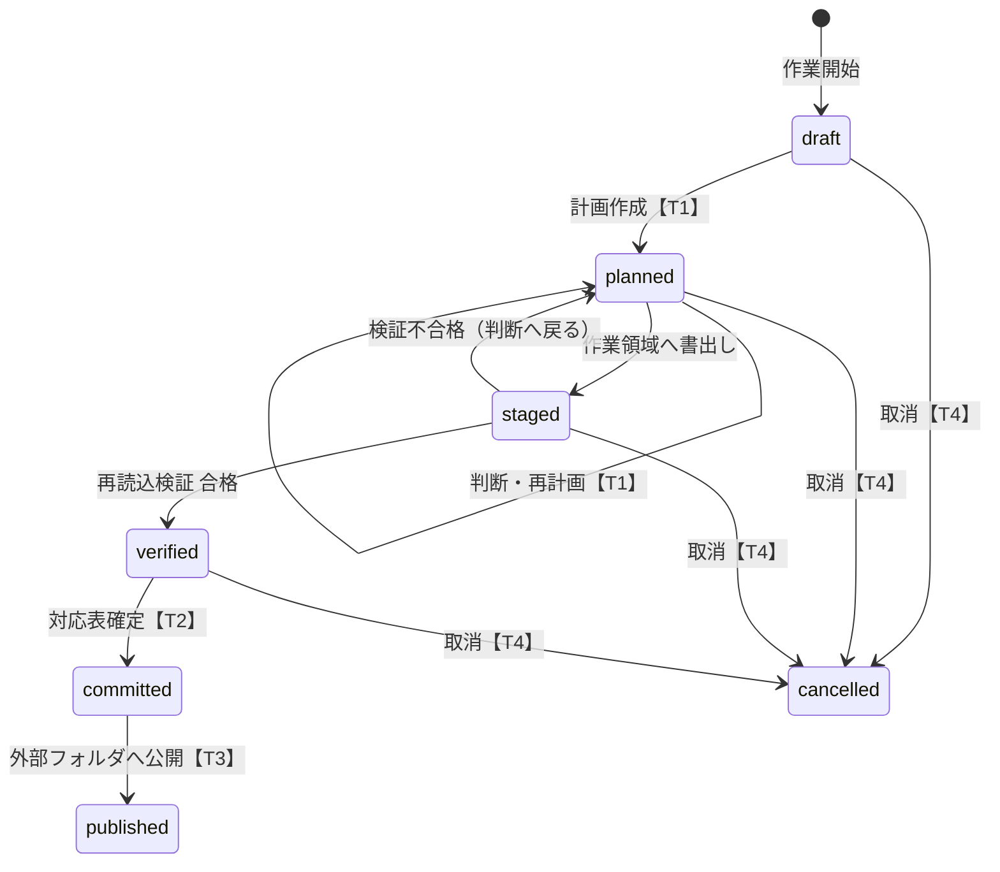

# 07 検証・出力・復旧設計とローカル保存の分離

## 1. 検証項目

検証は**作業領域に書き出した出力ファイルを、改めて読み込んで**行う（メモリ上の変換結果ではなく、実際に渡すファイルを検査する）。xlsx は自前の読込器に加えて、独立した第二の読込器（openpyxl）でも読み、両者の値が一致することを確認する。

xlsx では、元のブックと計画から期待されるセルの状態（値・型・書式・数式）を全セルについて出力と比べる（V1・V2・V5）。残存検査（V7）はセルの値・数式の文字列に加えて、ZIP 内の全 XML 部品の文字と属性値（シート名・名前定義・条件付き書式・入力規則・ヘッダーフッター・グラフ・コメント・関係定義のリンク先・ふりがな等）を対象にする。開発時は、合成データの出力を手元の Excel で開き、修復なしで開けることと、全再計算後の値が書き込んだキャッシュ値と一致することを自動で確認する（`pytest -m excel`。製品には含めない）。

| No | 項目 | 方法 | 不合格時 |
|---|---|---|---|
| V1 | 構造 | シート数・順序・名前、表の範囲の位置、行数・列数、CSV の行数・各行のフィールド数 | 停止（変換由来） |
| V2 | 維持した値 | 維持列の**全セル**について、格納値の文字列とセル型が元と完全一致 | 停止 |
| V3 | 集計（参考） | 維持した数値列の件数・合計を `Decimal` で計算（格納文字列から直接変換。浮動小数点を使わない）して表示 | V2 が合格なら情報表示のみ |
| V4 | 置換の一貫性 | 同じ元値→同じ変換値、異なる対象→異なる変換値、置換列に元値が残っていない | 停止 |
| V5 | 内容削除 | 指定列が空 | 停止 |
| V6 | 関連 | 確定した関連ごとに、元と出力で「一致件数」「未一致件数と未一致キー（変換後で対応付け）」「参照先の重複キー件数」「結合後の行数」を比較 | 変化があれば停止（変換由来）。元からの未一致・重複は「元データ由来」として記録し出力は可 |
| V7 | 元語句の残存 | 6.2 の範囲で、辞書の全語句（元名称・別名・元コード・値対応の元値・追加語句）を検索。正規化表記でも検索 | 停止（④の該当箇所へ） |
| V8 | 未確認 | 要確認の未決定件数 | 1件以上なら停止 |
| V9 | ファイル名・シート名 | 出力ファイル名・シート名・表の定義名の残存検査 | 停止 |
| V10 | 出力の健全性 | ZIP として正しいか、全XML部品が整形式か、コンテンツ種別と関係定義に不整合がないか | 停止 |
| V11 | 検査の対象外 | 画像・バイナリ部品の件数、短い語で自動判定しなかった件数 | 一覧表示（確認チェックで出力可） |

### 1.1 元由来と変換由来の区別

取込時に元データに対して同じ検査（V6 関連、重複、空欄）を行い、結果を `finding(origin=source)` として保存する。出力の検査結果と比較し、**元と同じ結果のものは元由来、元になかったものは変換由来**とする。変換由来の不備（block）は、利用者の判断で無視できない。

### 1.2 残存検査の範囲

| 範囲 | 検査 |
|---|---|
| 表の範囲内の全セル（維持列を含む） | する。維持列で元のコードと同じ数値が金額として現れるなど、偶然の一致は「数値列での一致」として情報表示 |
| 見出し、表の範囲外、非表示シート・行・列 | する |
| xlsx 内の全テキスト部品（XML） | する（共有文字列、数式、キャッシュ、グラフ、コメント、名前定義、プロパティ等すべて） |
| バイナリ部品（画像等） | しない（対象外として表示） |
| ファイル名・シート名 | する |

短い語（[05_algorithms.md](05_algorithms.md) 4.2）の一致は、人が「問題なし」と判断した箇所（位置と語句の組）を記録し、以後の検査で除外する。

## 2. 停止条件（まとめ）

次のいずれかに該当する場合、出力を確定しない。
1. V1, V2, V4, V5, V10 の不合格
2. V6 で変換由来の差
3. V7, V9 で元語句の残存（「問題なし」と判断済みの箇所を除く）
4. V8 の要確認が1件以上
5. 取込時の「未対応」機能が残っている（[06_file_support.md](06_file_support.md)）
6. 採番枯渇、コード規則違反
7. 出力先が原本と同じパス、または原本フォルダ・プロジェクトフォルダの内部

## 3. 作業の状態とトランザクション境界



| 境界 | 1回のデータベーストランザクションで行うこと |
|---|---|
| T1 計画 | 新規対象の仮登録、番号の確保（`next_*_seq` の更新）、要確認項目の作成・判断の記録。同じ作業の再計画では既存の仮登録を再利用 |
| T2 確定 | 作業の仮登録をすべて確定、master_event 記録、対応表版を進める、run_output（作業領域のファイルのハッシュ）記録、状態を committed に |
| T3 公開 | 作業領域から外部フォルダへ一時名でコピー → 書込完了を確認 → 正式名に改名 → ハッシュ確認 → 状態を published に（DB更新は最後の1回） |
| T4 取消 | 仮登録を void（番号は欠番）、作業領域を削除、状態を cancelled に |

**順序の理由**：外部フォルダへの公開（T3）は必ず対応表の確定（T2）の後に行う。これにより「外部に出たファイルの対応が未確定で、後から番号が変わる」状態が起きない。T2 の後に T3 が失敗しても、確定した対応は正しく、作業領域のファイルから再公開できる。

プレビュー（④）は T1 で確保した番号を使うため、プレビュー・出力・再起動後で番号は変わらない。

## 4. 異常終了からの復旧

起動時・プロジェクトを開く時に、状態が途中の作業を検出して処理する。

| 検出した状態 | 復旧処理 |
|---|---|
| draft / planned | そのまま再開可能（仮登録・判断は保存済み） |
| staged / verified | 作業領域のファイルを破棄し planned に戻す（再書出し・再検証） |
| committed（未公開） | 作業領域のファイルのハッシュが記録と一致すれば再公開を提案。一致しなければ確定済み対応から再生成して再検証 |
| published | 何もしない |
| 外部フォルダに一時名のファイルが残っている | 削除を提案（中身が完全でない可能性があるため） |

データベースは SQLite の WAL モードで運用し、起動時に整合性確認（quick_check）を行う。異常があればバックアップからの復元を案内する。

## 5. 出力の確定と追跡

- 外部向けフォルダに置くのは**変換後のファイルだけ**。対応表、原本、元の値を含む診断レポートは置かない。
- 出力ファイルに作業ID等を埋め込まない。追跡は project.db の run_output（ファイル名・ハッシュ・設定版・対応表版）で行う。
- 外部向けに渡せる「出力メモ」（検査した項目・対象外の範囲・「匿名化を保証しない」旨。元語句を含まない）を任意で出力できる。
- 元の値を含む詳細な検証レポートはプロジェクトフォルダ内の `reports/` にのみ保存する。

## 6. ローカル保存の分離

### 6.1 フォルダ構成

```
<プロジェクト保存先>\<プロジェクト名>\        ← 機密（元の値を含む）
  project.db            対応表・設定・履歴
  project.lock          同時使用防止
  originals\            取込時に複製した原本（読み取り専用）
  work\                 作業領域・一時ファイル（作業完了・取消で削除）
  reports\              元の値を含む検証レポート
  backups\              project.db の世代バックアップ
<外部出力フォルダ>\                           ← 外部提供用（変換後ファイルのみ）
```

- 外部出力フォルダをプロジェクトフォルダの内部や原本と同じフォルダに設定することは禁止する。
- 一時ファイルは Windows の共通一時フォルダ（%TEMP%）ではなく、プロジェクト内の `work\` に作る。

### 6.2 ログ・エラー・キャッシュ

| 対象 | 方針 |
|---|---|
| 操作ログ | 件数・位置（ファイルID・シート番号・行・列）・処理種別のみ。セルの値・ファイル名・シート名を記録しない |
| 例外 | 独自の例外処理で、例外メッセージ・変数の値を伏字化してから記録。ローカル変数を含むダンプを作らない |
| クラッシュ | 自動送信しない。ローカルに伏字化した記録のみ |
| LLM の入出力 | 既定で記録しない。調査用に記録する設定はプロジェクト内 `reports\` にのみ保存し、画面に警告を出す |
| 画面のキャッシュ | プレビュー用データはメモリまたは `work\` 内のみ |
| OS の最近使ったファイル | アプリから登録しない |

### 6.3 バックアップと保護（暗号化は未決）

- 対応表の確定（T2）前に、SQLite のオンラインバックアップ機能で `backups\` に世代バックアップを作る（既定10世代）。
- プロジェクトのバックアップ・移行用に、プロジェクトフォルダ全体を1ファイルにまとめる機能（機密扱いとして表示）。

暗号化の選択肢（アプリ独自の暗号化は求められていないため、初期版は案aで確定。b・c は将来の選択肢として記載）：

| 案 | 内容 | 長所 | 短所 |
|---|---|---|---|
| a. OSのディスク暗号化に任せる | BitLocker 等＋利用者のみアクセス可能なフォルダ | 実装不要、鍵紛失リスクが低い | 端末にログインできる人には見える。バックアップ先での保護は別途必要 |
| b. Windows の利用者単位保護（DPAPI）で鍵を保護 | アプリがデータ鍵を作り、DPAPI で保護して保存。DB・原本を暗号化 | パスワード入力不要 | Windows アカウント・端末に紐づき、移行や復旧が難しい |
| c. パスフレーズ方式 | パスフレーズから鍵を導出し、DB（SQLCipher 等）・原本を暗号化 | 端末に依存しない、持ち運び可 | パスフレーズを忘れると復元不可。ライブラリのライセンス・配布確認が必要 |

決定（2026-11-03）：初期版は a。アプリはプロジェクトフォルダを利用者本人のみアクセス可能なアクセス権で作成し、「機密情報を含むフォルダです」と画面に表示する。保存処理は「保護層」を差し替え可能な構造にしておき、要件が出た場合に b または c を追加する。
